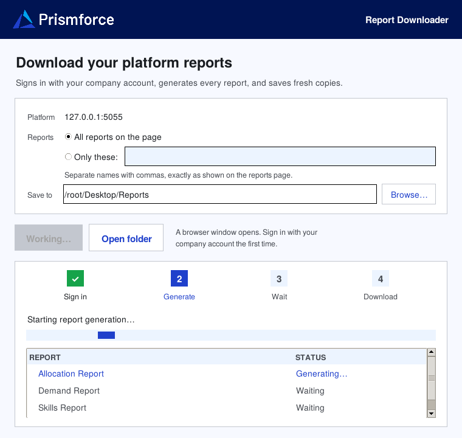

# 01 · Report Download Agent

An unattended browser agent that downloads every report from a SaaS platform and tells the team how it went.

## Problem
Ops teams needed a fresh set of reports from the platform every day. Each report had to be opened, filtered, generated, waited on and downloaded by hand.

## How it works

```
login → open reports page
  │
  ├─ PHASE 1: trigger ALL reports      → email #1 "run started"
  ├─ wait N seconds for server to build
  └─ PHASE 2: for each report
        download only files stamped after this run's trigger time
        retry up to 3× if not ready
  │
  └─ log to Excel → email #2 SUCCESS / PARTIAL / FAILED
```

Triggering everything first and then downloading cuts total run time. The server builds reports in parallel instead of one at a time.

## Interesting problem I solved
The platform's report cards sit inside a header the UI framework marks `aria-disabled="true"`. A human can click the buttons, but Playwright refuses because it thinks they're disabled. I added `robust_click()`, which escalates **normal click → force click → raw DOM event**.

A second bug: after a successful download, closing the panel sometimes failed. That marked good reports as failed. Cleanup now runs `best_effort()` so it can never override a real result.

A third fix: if a report was still showing *"Generating..."* when the agent came back to download it, the run crashed and no log or email went out. The agent now skips unfinished rows and retries. If login fails or the site is down, every report is marked FAILED and the run is still logged and emailed.

## Files
| File | Role |
|------|------|
| `agent.py` | Playwright core: login, trigger, download, orchestration |
| `notifier.py` | SMTP email summaries |
| `report_log.py` | Excel run log, CSV fallback when the workbook is locked |
| `scheduler.py` | Headless CLI: `--once` or `--at 08:30` |
| `report_agent_gui.py` | The desktop app (branded window). This is what `report_agent.exe` runs |
| `report_agent_app.py` | Settings and config helpers (also a text-mode version of the app) |
| `branding/` | Official logo and icon from the brand kit |
| `webapp.py` | One-button local web UI for teammates |
| `config.example.json` | All URLs, selectors and report names, so no code edits are needed |
| `tests/mock_platform.py` | A fake reports site with the same page structure (and a simulated SSO sign-in with `MOCK_SSO=1`), for testing without the real platform |

## Easiest: the Windows app (no Python, no command prompt)



1. Download **report_agent.exe** from the repo's **Releases** (`report-agent-latest`).
2. Double-click it. If Windows warns, click **More info → Run anyway** (the app is unsigned).
3. Choose **All reports** (or type a few names) and where to save. Both are remembered.
4. Click **Download reports**. A browser window opens. **Sign in with your company account (SSO)** the first time. The sign-in is remembered for later runs.
5. Watch it work: **Sign in → Generate → Wait → Download**, with each report's status live. The folder opens when it's done.

No usernames, passwords or emails are asked or stored. The app uses **Microsoft Edge** (already on every Windows PC) or Chrome.

**For maintainers:** the address comes from the GitHub repo variable `PLATFORM_URL` (Settings → Secrets and variables → Actions → Variables). It's never in the code. Every push builds the .exe on Windows, **tests it against the mock platform**, and only then publishes it.

## Run with Python
```bash
pip install -r ../requirements.txt && playwright install chromium
cp config.example.json config.json   # fill in URL, login, selectors
python scheduler.py --once           # or: python webapp.py
```
`config.json` is git-ignored so credentials never get committed.

## Test without the real platform
`tests/mock_platform.py` copies the real UI's tricky parts: aria-disabled headers, a two-step generate, a stale file from yesterday, "Generating..." rows, and one broken report.
```bash
python tests/mock_platform.py 5055 5        # fake site on port 5055, reports ready after 5s
cp tests/config.mock.json config.json
python scheduler.py --once                  # expected: PARTIAL (3 downloaded, Broken Report failed)
```
Scenarios verified: normal run (3 fresh files downloaded, stale file ignored), report still generating (clean FAILED, no crash), platform down (all FAILED, still logged and emailed), and the one-click web UI.

## Next step
Replace hard-coded selectors with an LLM-guided step ("find the Generate button for report X") so the agent survives UI changes.
